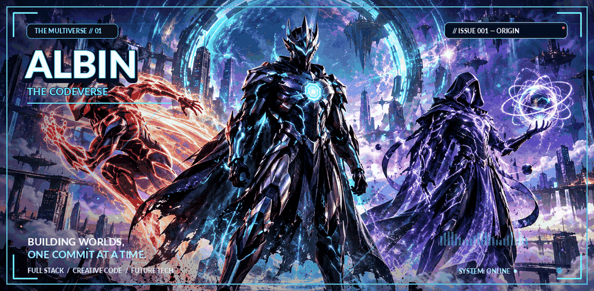
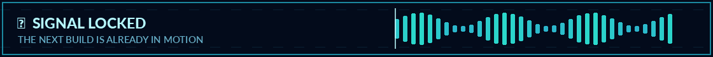
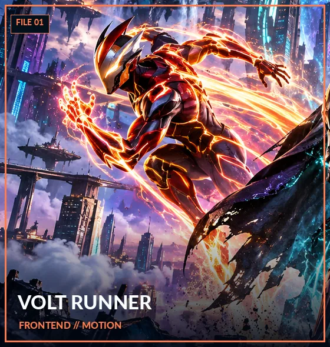
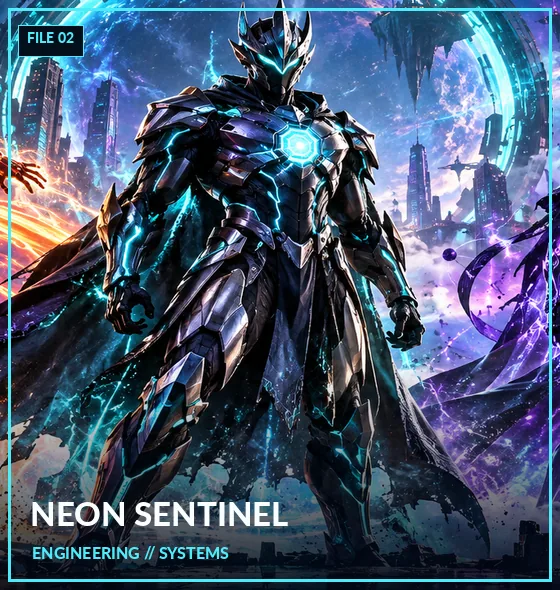
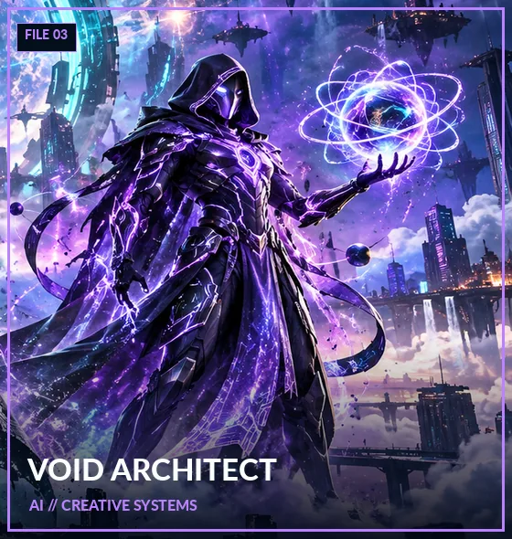
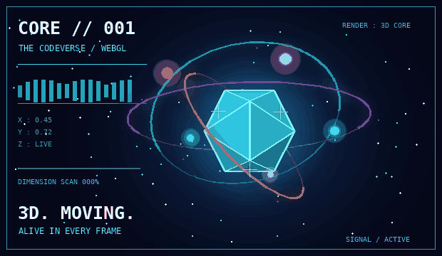

<!--
  ALBIN // THE CODEVERSE — GitHub Profile README
  Art: original AI-assisted artwork; motion overlays and layout are custom-made.
  README-compatible effects are animated GIFs (no scripts/iframes).
  The live 3D effect is served from experience/ when GitHub Pages is enabled.
  To retire the old animation, remove its old README  reference.
-->

<div align="center">

<a href="https://albin170.github.io/" title="Enter Albin's universe">
  
</a>

<br/>



<br/>

### `⟨ DEVELOPER ⟩` &nbsp; `⟨ CREATIVE ENGINEER ⟩` &nbsp; `⟨ DIGITAL WORLD-BUILDER ⟩`

**I don't just build websites. I build experiences worth exploring.**

[](https://albin170.github.io/)
[](https://albin170.github.io/albin170/experience/)
[](https://github.com/albin170?tab=repositories)
[](https://albin170.github.io/eia-green-infrastructure/)

</div>

---

## `01 // ORIGIN STORY`

> **Some write code. Some tell stories. I want to do both.**

I'm **Albin**, a developer drawn to immersive interfaces, useful software, and ideas that feel a little impossible at first. I experiment with modern web experiences, motion, visual storytelling, and AI-assisted creativity—turning an idea into something people can actually use.

```text
╭───────────────────────────────────────────────────────╮
│  [ ALBIN.OS ]                                ● ONLINE │
├───────────────────────────────────────────────────────┤
│  CLASS          Creative developer                   │
│  SPECIALTY      Frontend experiences & web projects   │
│  SIDE QUESTS    Animation · UI concepts · AI tools   │
│  CURRENT MODE   Designing the next experiment        │
│  MISSION        Make the web feel extraordinary       │
╰───────────────────────────────────────────────────────╯
```

## `02 // THE HERO PROTOCOL`

<div align="center">

**Three original avatars. Three sides of the same creative process.**

<table>
  <tr>
    <td align="center" width="33%">
      
      <br/><b>⚡ VOLT RUNNER</b>
      <br/><sub>The Motion Layer</sub>
    </td>
    <td align="center" width="33%">
      
      <br/><b>🛡️ NEON SENTINEL</b>
      <br/><sub>The Engineering Layer</sub>
    </td>
    <td align="center" width="33%">
      
      <br/><b>🌌 VOID ARCHITECT</b>
      <br/><sub>The Imagination Layer</sub>
    </td>
  </tr>
</table>

</div>

### `3D REACTOR // ACTIVATED`

<div align="center">

<a href="https://albin170.github.io/albin170/experience/">
  
</a>

<sub>⚡ <b>THIS IS THE ANIMATED README PREVIEW.</b> The companion website has a real, mouse-responsive 3D WebGL reactor, reactive superhero cards, speed-warp effects, and moving particles. Deploy GitHub Pages to activate the link.</sub>

</div>

| **POWER MODULE** | **WHAT IT UNLOCKS** |
|:--|:--|
| ⚡ **Visual Velocity** | Motion design, animated interfaces, and memorable page transitions |
| 🛡️ **System Core** | Functional, accessible, responsive experiences |
| 🌌 **Reality Forge** | Prototyping, experimental interaction, and AI-assisted ideation |
| 🪐 **World Building** | Taking concepts from early sketches to polished web experiences |

---

## `03 // FEATURED MISSIONS`

<table>
<tr>
<td width="100%">

### 🌿 EIA: Green Infrastructure

**Mission status:** `LIVE` · **Category:** `Interactive website`

An environmental-impact and green-infrastructure experience exploring how a serious topic can become a clear, engaging, visual story.

**[🚀 LAUNCH LIVE EXPERIENCE](https://albin170.github.io/eia-green-infrastructure/)** &nbsp; · &nbsp; **[🌐 VISIT MY WEBSITE](https://albin170.github.io/)**

</td>
</tr>
</table>

<details>
<summary><b>🗂️ OPEN THE MISSION ARCHIVE</b> — More experiments and code</summary>
<br/>

Explore my public repositories for ongoing builds, UI experiments, and ideas in progress:

**[→ OPEN ALL GITHUB REPOSITORIES](https://github.com/albin170?tab=repositories)**

</details>

---

## `04 // THE TECH REACTOR`

<div align="center">

**Areas I explore**


<br/><br/>

**My approach:** `IMAGINE` → `DESIGN` → `BUILD` → `REFINE` → `SHIP`

</div>

---

## `05 // TRANSMISSION FROM THE FUTURE`

> _"The best interface isn't just beautiful. It makes an idea feel alive."_

<div align="center">

### ⚡ HAVE A MISSION IN MIND?

Whether it's a playful front end, a thoughtful product concept, or an experimental visual build, the next mission starts with a good idea.

[](https://github.com/albin170)
[](https://albin170.github.io/)

<sub>◈ CODEVERSE FILES // CREATED FOR ALBIN // EST. 2026 ◈</sub>

**`END OF ISSUE #001 — THE NEXT ONE IS BEING BUILT`**

</div>
